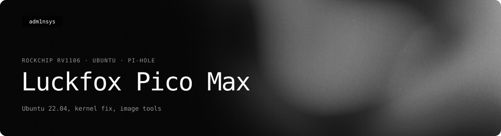
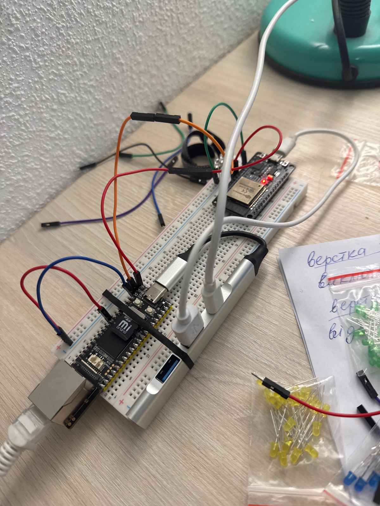
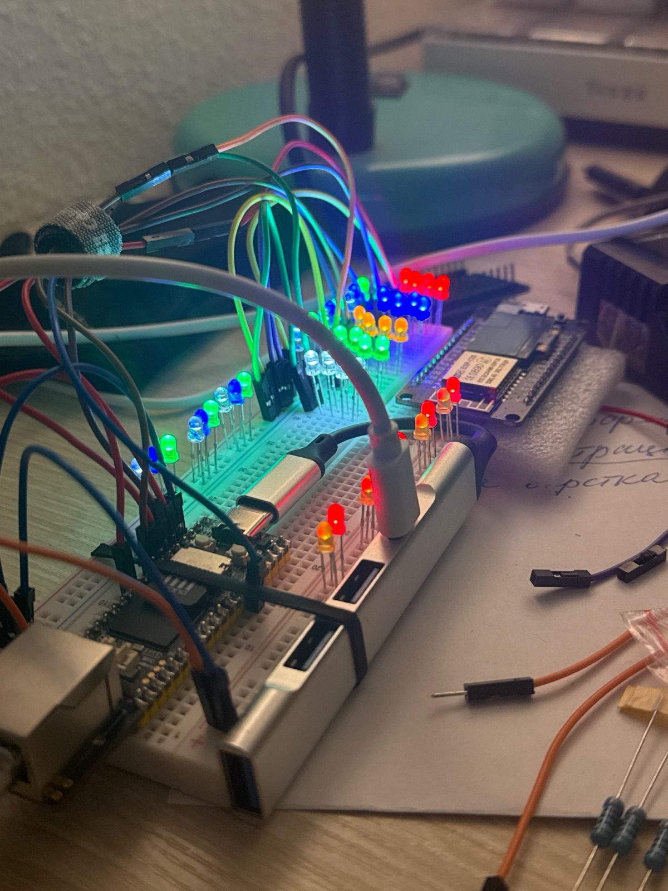

<picture>
  <source media="(prefers-color-scheme: light)" srcset=".github/readme/banner-light.svg">
  
</picture>

  
  
  
  
  

How to get Ubuntu 22.04 running on the Luckfox Pico Max (Rockchip RV1106) after Luckfox dropped it from its SDK, make the board shut down instead of rebooting, and understand the SD card layout and image formats the SDK leaves undocumented. That is the hard part. Once Ubuntu runs, the board behaves like a Raspberry Pi Zero, and Pi-hole goes on top with the usual instructions.

The result of months of work with the board's kernel, root filesystem and SDK — documented so that nobody has to repeat it.

  
  

*My Luckfox Pico Max (front, with the Ethernet port) on the breadboard with an ESP32 and a USB hub — and the same setup with an LED garland wired up.*

## In short

| | |
|---|---|
| **Board** | Luckfox Pico Max — RV1106, 256 MB RAM, 256 MB SPI NAND, Ethernet; Ubuntu runs from an SD card |
| **System** | Ubuntu 22.04.3 LTS, built from the last Luckfox SDK commit that still includes it |
| **Fix** | kernel option that stops `shutdown` from rebooting the board |
| **Use** | always-on Pi-hole DNS server for the home network — installed the same way as on a Pi Zero |
| **Known limits** | 256 MB RAM (swap needed); no SPI drivers on Ubuntu; the board cannot cut its own power; the SD card overheats |

## Guides

1. **[Build Ubuntu for the Pico Max](docs/build-ubuntu.md)** — SDK commit, board config, kernel option, flashing, first boot.
2. **[Shutting down without breaking it](docs/power-off.md)** — why shutdown reboots, the kernel fix, and what goes wrong under load.
3. **[Pi-hole](docs/pihole.md)** — the easy part: static address, the standard installer, router setup.
4. **[What is inside the SDK's images](docs/image-formats.md)** — Rockchip's RKFW, LDR and RKNS containers, and a tool that reads them on any OS.
5. **[The SD card layout](docs/storage.md)** — no partition table, only 8 GB of the card in use, and how to fix that before building.
6. **[Living with 256 MB of RAM](docs/memory.md)** — zram for every day, a big temporary swap for building zigbee2mqtt or Homebridge.
7. **[Keeping the SD card alive](docs/sd-card.md)** — the card sits above the processor; cooling and fewer writes.

## Scripts

| Script | What it does | Origin | Tested on the board |
|---|---|---|---|
| [`scripts/check-image.sh`](scripts/check-image.sh) | Reads board name, storage type and partition layout from SDK images — catches images built for the wrong board before flashing. macOS and Linux. | new | on real images ✅ |
| [`scripts/rkimage.py`](scripts/rkimage.py) | Reads Rockchip's image formats (update.img, download.bin, idblock.img, FIT, U-Boot env) on any OS and unpacks update.img — no dependencies. | new | on real images ✅ |
| [`scripts/static-ip.sh`](scripts/static-ip.sh) | Gives the board a fixed Ethernet address, with validation and a backup of the old config. | rewrite of my original script | original ✅, rewrite ❌ |
| [`scripts/install-pihole.sh`](scripts/install-pihole.sh) | Installs Pi-hole with the official installer and makes it start on boot (systemd or rc.local). | based on my setup script | original ✅, rewrite ❌ |
| [`scripts/safe-shutdown.sh`](scripts/safe-shutdown.sh) | Stops heavy services one by one, flushes the SD card and halts. | re-creates my lost script (stop everything, then halt) | ❌ |
| [`scripts/build-swap.sh`](scripts/build-swap.sh) | Adds a big temporary swap file with aggressive swapping for compiling Node.js projects, and removes it afterwards. | new helper — I did this by hand | ❌ |

These are patches, not a cure: the board still cannot cut its own power, and a hung system will not be saved by a script.

## Why this exists

The Pico Max looked like a cheaper alternative to a Raspberry Pi Zero. In practice:

- `shutdown now` and `poweroff` **reboot** the board. Reading the datasheet showed why: the power-off pin is not connected, and Luckfox's kernel turns every power-off into a restart. Support did not see it as a problem. The fix ended up in the kernel config — and even then, with zigbee2mqtt and Homebridge pushing the board to full load, every second shutdown ended in a hard power cut. See [power-off.md](docs/power-off.md).
- The card has **no partition table** — the layout lives in the bootloader environment, so no PC can read it — and only **8 GB of a 64 GB card** were in use; adding space on the running system means praying nothing writes in the background. See [storage.md](docs/storage.md).
- **256 MB of RAM** is not enough for Ubuntu with a few services: it ran with a 1 GB swap file on the card, and building zigbee2mqtt needed several gigabytes of aggressive swap — see [memory.md](docs/memory.md).
- The **SD card sits right above the processor**, gets hot and dies early — and swap on it makes that worse. See [sd-card.md](docs/sd-card.md).
- **Ubuntu disappeared** from the official SDK in 2025, and working images were hard to find even on Chinese forums. The SDK history still has it, pinned to the right commit in [build-ubuntu.md](docs/build-ubuntu.md).
- **SPI** works on the vendor's Buildroot image but has no drivers on Ubuntu, with documentation that is partly Chinese and incomplete.
- The SDK's board menu **produced images for the wrong board** — found out only after flashing. Hence `check-image.sh`.
- The images themselves are **Rockchip containers no common tool opens** — on Linux, macOS or Windows. Hence `rkimage.py`, see [image-formats.md](docs/image-formats.md).

Debugging all of this without a USB-UART adapter at hand led to a side project: **[iUART](https://github.com/adm1nsys/ESP32-iUART)**, a wireless serial console on an ESP32.

## About this repository

The experiments, builds and findings are my own — months with this board's kernel, root filesystem and SDK. The documentation and the helper scripts were written together with Claude (Anthropic's AI assistant) from my notes and from what I described; the table above says which scripts come from my original setup and which were tested on the board.

## Notes

- Ubuntu images are not distributed here — my prebuilt ones are available on request. Everything is built from Luckfox's public repositories ([luckfox-pico](https://github.com/LuckfoxTECH/luckfox-pico), [pico_ubuntu](https://github.com/luckfox-eng33/pico_ubuntu)); this repository contains only documentation and scripts.
- Not affiliated with Luckfox or Canonical. Ubuntu is a trademark of Canonical Ltd.

## License

[MIT](LICENSE) © Heorhii Romanenko
