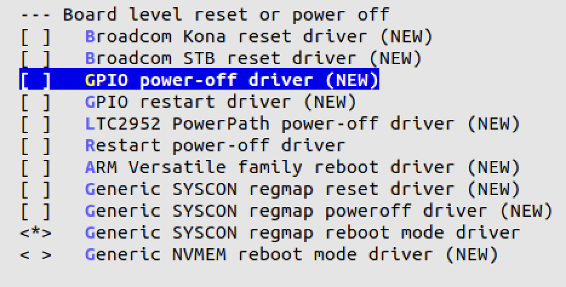

# Why `shutdown -h now` reboots the Luckfox Pico Max

## Symptom

`sudo shutdown -h now`, `poweroff` or `systemctl poweroff` — and a few seconds later the board boots again. There is no way to turn it off from software.

## Cause

Two things come together:

1. **The hardware cannot switch itself off.** The Pico Max has no PMIC power-off path: the pin that would request power-off is left unconnected on the board, so nothing can actually cut the supply. The datasheet shows it; Luckfox support did not treat it as a bug.
2. **The kernel turns "power off" into "restart".** Luckfox's kernel config enables the *Restart power-off driver* (`CONFIG_POWER_RESET_RESTART=y` in `luckfox_rv1106_linux_defconfig`). When nothing else can power the board off, this driver handles the power-off request by restarting the system — which is exactly the reboot loop.

## Fix in the kernel

Disable the driver before building (see [build-ubuntu.md](build-ubuntu.md), step 3):

```
Device Drivers
  → Board level reset or power off
    → [ ] Restart power-off driver        # CONFIG_POWER_RESET_RESTART=n
```



Now a power-off request halts the system instead of restarting it.

## What it does not fix

The board still stays powered — there is no switch to open. And `poweroff` on this image did not always finish cleanly in practice, with a real risk of a damaged root filesystem on the SD card. What works reliably:

```bash
sudo halt
```

Wait until the serial console shows `reboot: System halted` (all filesystems are unmounted by then) and only then remove power.

## Also seen on the way

- **SPI on Ubuntu:** the SPI peripherals that work on Luckfox's Buildroot image have no working drivers in the Ubuntu build, and the vendor documentation is partly Chinese and incomplete. Writing those drivers was out of scope, so this Ubuntu image is used without SPI.
- **Wrong board in the SDK menu:** building with the SDK's board menu has produced images for a different board than selected — after hours of building. [`scripts/check-image.sh`](../scripts/check-image.sh) reads the board name and storage layout straight from the image, so this is caught before flashing.
